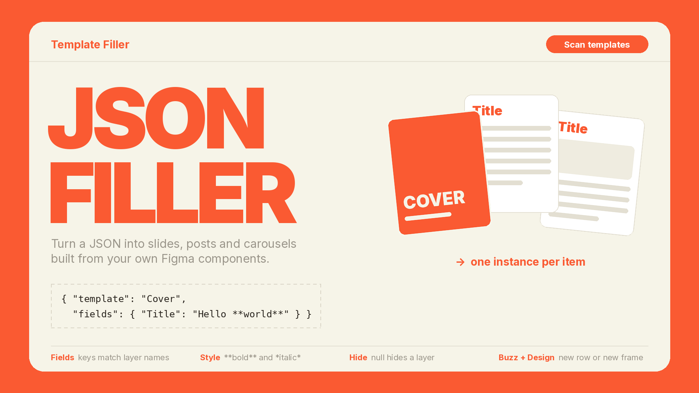

# JSON Template Filler

Turn a JSON into ready-made slides, social posts and carousels built from **your own components**. Works in **Figma Design** and **Figma Buzz**.

Scan your templates to get an example JSON, fill it in with your content and generate: one instance per item, every layer filled by name. Perfect for recurring carousels, posts and slide sets.



## Features

- **Scan templates** – lists every local component and component set, and writes an example JSON with all the fillable layers.
- **Generate** – creates one instance per item and fills text and image layers by name.
- **Rich text** – `**bold**` and `*italic*` use the matching styles of the font already in your template.
- **Hide layers** – set a field to `null` and the layer disappears; with auto layout the gap closes automatically.
- **Images from URLs** – image layers are filled from direct image links.
- **Variants and properties** – pick a variant of a component set and set boolean or text component properties.
- **Reminders** – add a `note` to an item and it is shown after generation (e.g. which picture still needs to be added).
- **Figma Buzz aware** – in Buzz each set lands in a new row at the bottom of the canvas grid, named after the set.
- **Live validation** – the editor tells you whether the JSON is valid and how many items it contains. You can also drop a `.json` file on it.

## How it works

1. Build your templates as local components (e.g. `Cover`, `Text slide`, `Image slide`, `End`). Give meaningful names to the layers you want to fill (`Title`, `Body`, `Photo`…).
2. Run the plugin and press **Scan templates**: the editor is filled with an example JSON, one item per template.
3. Duplicate, reorder and fill the items with your content, or paste/drop a JSON you prepared elsewhere.
4. Press **Generate** (or Ctrl/⌘ + Enter).
   - **Figma Buzz**: the items are placed in a new row at the bottom of the canvas grid.
   - **Figma Design**: the items are placed side by side in a new auto-layout frame, to the right of the existing content.

## JSON format

```json
{
  "name": "Episode 39",
  "slides": [
    { "template": "Cover", "fields": { "Title": "Will quantum computers break the Internet?" } },
    { "template": "Text slide", "fields": { "Title": "The lock of the Internet", "Body": "Every time you open **home banking**…" } },
    { "template": "Text slide", "fields": { "Title": null, "Body": "Continuation without a heading." } },
    { "template": "Image slide", "fields": { "Photo": "https://example.com/photo.jpg", "Body": "…" }, "note": "Check the photo credits" },
    { "template": "Card", "variant": { "Size": "Large" }, "props": { "Show badge": false }, "fields": { "Label": "New" } }
  ]
}
```

| Key | Meaning |
|---|---|
| `name` | Optional name of the set: used for the Buzz row, the Design frame and the generated instances. |
| `slides` | Items to create, in order. A bare array (without `name`) works too. |
| `template` | Name of a local component or component set. |
| `variant` | For component sets: the variant properties to pick. Otherwise the default variant is used. |
| `props` | Component properties (boolean or text) by name. |
| `fields` | Layer name → value. See below. |
| `note` | Reminder shown in the plugin after generation. |
| `gap` | Optional spacing between items in the Figma Design frame (default 80). |

### Field values

| Value | Result |
|---|---|
| `"Some text"` | Replaces the text of a text layer. Supports `**bold**` and `*italic*`; escape a literal asterisk with `\*`. |
| `"https://…/image.jpg"` | Fills a shape or frame with the image (scaled to fill). |
| `null` or `false` | Hides the layer. |
| `{ "visible": false }` | Hides the layer (explicit form). |

Every layer with the given name inside the instance is filled, including layers inside nested instances. Keys starting with `_` are ignored, so you can use them for comments.

## Tips

- Use unique, descriptive layer names inside each component: the scan reports names shared by several layers.
- Auto layout in your components lets hidden layers collapse cleanly.
- Image URLs must be publicly reachable direct links to PNG, JPG or GIF files.
- Fonts must be available to Figma. If a bold or italic style doesn't exist for a font, the text stays regular and you get a warning.

## Limitations

- Only **local** components are used as templates (not components from a library).
- Figma Design and Figma Buzz are supported; FigJam and Figma Slides are not.

## Privacy

The plugin only reads and edits the current file and does not collect, store or send any data. Network requests:

- the image URLs you put in the JSON, to fill image layers;
- Google Fonts, to load the Inter font used by the plugin interface.

## Development

The plugin is written in TypeScript (`code.ts`) and compiled to `code.js`; the interface is `ui.html`.

```bash
npm install
npm run build   # or: npm run watch
```

Then in the Figma desktop app: Plugins → Development → Import plugin from manifest… and pick `manifest.json`.

## License

MIT – see [LICENSE](LICENSE).
